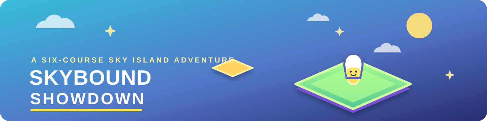
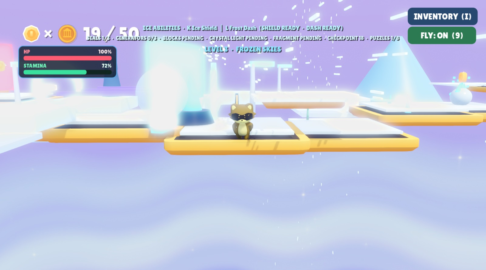
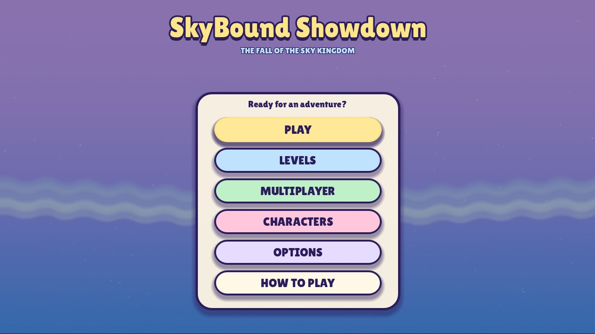
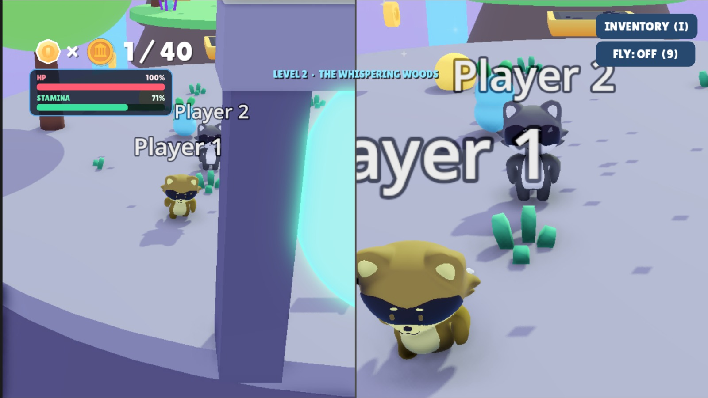
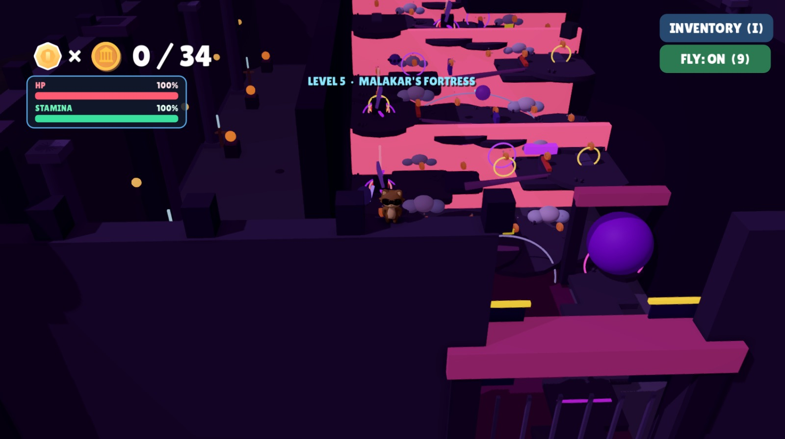

# ☁️ SkyBound Showdown

  

  <strong>Five courses. Two dimensions. One sky-high showdown.</strong> 
  A 3D platform adventure with local and online multiplayer, made with Godot 4.7.

  <a href="#-the-adventure">The adventure</a> · 
  <a href="#️-multiplayer">Multiplayer</a> · 
  <a href="#️-choose-your-course">Five Courses</a> ·
  <a href="#-controls">Controls</a> · 
  <a href="#-run-the-game">Get Started</a>

---

## 🌤️ The adventure

The sky is your playground—and falling is part of the lesson.

Journey across floating kingdoms, collect coins, solve environmental puzzles, rescue trapped creatures, defeat corrupted guardians, and recover the Fragments of the Eternal Tree. When the path disappears, shift between the **Material** and **Mirror** dimensions to reveal alternate platforms and routes. Use double jumps, time your moves, and keep your nerve as each level introduces new challenges.

**Your goal:** recover the Eternal Tree fragments, unlock their portals, and master all five courses.

## ✨ Make every jump count

- 🌀 **Shift dimensions** — press **Q** to switch between Material and Mirror routes.
- 🪙 **Collect every coin** — explore the course and aim for a perfect run.
- 🏃 **Move with precision** — run, jump, and double-jump across the islands.
- ⚔️ **Master the Combat** — unlock attack moves to clear your path.
- 🎭 **Choose your Hero** — play as Nattie, Isabelle, or the Raccoon, each with unique styles.
- 🎒 **Use your inventory** — manage collected items during a course.
- 🪽 **Take flight when needed** — use the fly toggle while exploring and testing routes.
- ⏱️ **Freeze time** — use a brief time-freeze to help plan tricky moves.
- ❄️ **Survive Frozen Skies** — cross slippery ice, crystal routes, and the Frost Titan's arena in Level 3.
- ⚠️ **Read the hazards** — dodge spinning sweepers, falling platforms, hurdles, and maze walls.
- 💛 **Use checkpoints** — reach checkpoint beacons to save your respawn point.
- 🚩 **Solve and finish** — activate the switches, open the gates, and reach the flag.
- 💾 **Continue your journey** — resume exactly where you left off with the new progress system.

## 📸 Gallery

  
  

  
  

  
  
  

## 🧠 Game Systems

- **Game State Manager** — Centralized single source of truth for level progress, game status, coins, and player data. Synchronizes state across clients in online play.
- **Progress Tracking** — Automatic save/resume support keeps you exactly where you left off.

## 👥 Multiplayer

Race against your friends or tackle the courses together.

- 📺 **Local Co-op** — split-screen action for two players on one machine. Full support for dual controllers or shared keyboard.
- 🌐 **Online Co-op** — join a room via IP address and hop through dimensions with friends over the network.
- 🛡️ **Secure Networking** — hardened RPC system with heartbeat monitoring, timeout detection, and improved error handling.

---

## 🏝️ Choose your course

| # | Course | Your challenge |
|---|---|---|
| 1 | **Forgotten Island** | Defeat the Island Warden, recover the First Fragment, collect 30 coins, and awaken the portal. |
| 2 | **The Whispering Woods** | Solve forest puzzles, rescue trapped creatures, defeat the Shadow Wolf, recover the Second Fragment, and collect 40 coins. |
| 3 | **Frozen Skies** | Cross six frozen regions, unlock ice abilities, defeat the Frost Titan, recover the Third Fragment, and collect 50 coins. |
| 4 | **Ember Heights** | Cross the Molten River, activate the Magma Crystals and Ancient Energy Machines, escape the Rising Lava Chamber, defeat the Ember Dragon, and recover the Fourth Fragment. |
| 5 | **Malakar's Fortress** | Cross the corrupted island, align three energy conduits, infiltrate the fortress, and survive Malakar's encounter. |

The adventure continues through Levels 4–5 and the final confrontation in Malakar's Fortress. No course is quite the same: switch dimensions, watch the timing, and explore every route for hidden coins.

## 🎮 Controls

### ⌨️ Standard Controls
| Action | Keyboard / mouse | Xbox / PC Controller | PS5 / PS4 Controller | Handheld (Switch/SteamDeck) |
|---|---|---|---|---|
| Move | W, A, S, D | Left stick | Left stick | Left stick |
| Look around | Mouse movement | Right stick | Right stick | Right stick |
| Jump / double jump | Space / left click | A | Cross ($\times$) | A / South |
| Shift dimension | Q / right click | Left bumper (LB) | L1 | L |
| Freeze time briefly | F | Y | Triangle ($\triangle$) | B / East |
| Activate a nearby switch | E | X | Square ($\square$) | X / West |
| Ice Shield (Level 3) | K | Left trigger | L2 | ZL |
| Frost Dash (Level 3) | L | Right bumper (RB) | R1 | ZR |
| Attack | J | B | Circle ($\bigcirc$) | B / East |
| Inventory | I | View button | Touchpad / View | Minus / View |
| Fly toggle | 9 | Left stick click | Left stick click | Left stick click |
| Zoom camera | Mouse wheel | Triggers | Triggers | Triggers |
| Navigate menus / select | Mouse click | D-pad or left stick / A | D-pad / Cross ($\times$) | D-pad / A |
| Return / back | Esc | B | Circle ($\bigcirc$) | B / East |

### 🥽 VR Controls
| Action | VR Controller |
|---|---|
| Move | Left Thumbstick |
| Look around | Head Movement (HMD) |
| Jump / double jump | A / Trigger |
| Shift dimension | X / B Button |
| Freeze time briefly | Y Button |
| Activate a nearby switch | Grip / Trigger |
| Zoom camera | Right Thumbstick |
| Menu / Pause | Menu Button |

**First-time tip:** try switching dimensions with **Q** whenever a route seems blocked. Material and Mirror have different platforms and selected hazards, so changing the world can reveal another way forward.

## 🚀 Run the game

1. Install **[Godot 4.7 or later](https://godotengine.org/download/)**.
2. Clone or download this repository.
3. Open the root `project.godot` file in Godot.
4. Press **F5** to launch the game, or **F6** to run the home screen.

From the home screen, you can start playing, choose a course, or review the controls.

## 📦 Export a build

Want to share your game outside the editor?

1. Open the project in Godot.
2. Install the matching Godot export templates if prompted.
3. Open **Project → Export**, choose your target platform, and export the build.

## 🙌 Credits and licenses

SkyBound Showdown is rebuilt and owned by **Atsila Devs**. See [LICENSE.md](LICENSE.md) for the project's license. Included models, sprites, and sound effects retain their original asset credits and licenses; the Lilita font license is in [fonts/license.txt](fonts/license.txt).

---

  <strong>Find your footing. Shift your world. Own the sky.</strong>

Built with passion and precision.
